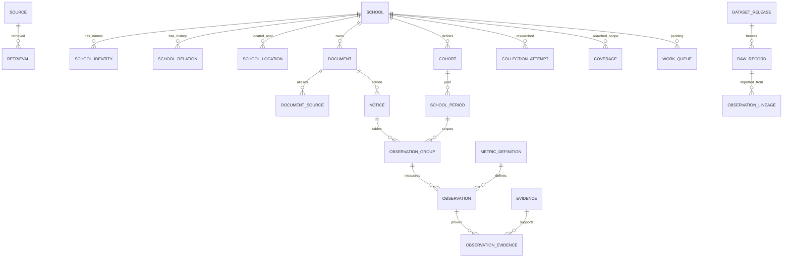

# Data dictionary and relationships

Counts are nonnegative integers. Numeric zero is observed evidence, not a missing-value default. Unknown scalar values are SQL NULL. `academic_year` is normalized YYYY/YYYY; original source strings remain in raw payloads/evidence. Source labels and source SHA256 always remain available; IDs are deterministic hashes except school roll text. Publication date, archive capture UTC identifier, retrieval instant, metric asof and school year are distinct. `definition_era` marks pre2020 records for changing-definition review if discovered. `source_label` is exact-reviewed cohort wording, while intake kind and explicit needs labels support filtering without inventing a catchment.

Metric definitions are data in `metric_definition`. The comparable view deliberately excludes unsupported numeric assertions, ambiguous years/cohorts, interest/eligible-only/base-excluding-late application quantities and inferred acceptance sums from an unqualified full funnel. Cross-edition conflicts remain inspectable, even when one edition is deterministically preferred.

## Tables and columns

### cohort

|Column|Type|Required|Primary key|
|---|---|---|---|
|cohort_id|TEXT|yes|1|
|roll|TEXT|yes||
|source_label|TEXT|yes||
|intake_kind|TEXT|yes||
|special_needs_label|TEXT|no||
|scope_confirmed|INTEGER|yes||

### collection_attempt

|Column|Type|Required|Primary key|
|---|---|---|---|
|attempt_id|TEXT|yes|1|
|roll|TEXT|no||
|source_id|TEXT|no||
|method|TEXT|yes||
|attempted_at|TEXT|no||
|status|TEXT|yes||
|exact_status|TEXT|no||
|query_text|TEXT|no||
|requested_from|TEXT|no||
|requested_to|TEXT|no||
|coverage_limit|TEXT|no||
|raw_id|TEXT|no||
|details_json|TEXT|yes||

### coverage

|Column|Type|Required|Primary key|
|---|---|---|---|
|coverage_id|TEXT|yes|1|
|roll|TEXT|yes||
|academic_year|TEXT|no||
|coverage_dimension|TEXT|yes||
|status|TEXT|yes||
|source_id|TEXT|no||
|as_of|TEXT|no||
|scope_limit|TEXT|yes||
|raw_id|TEXT|no||

### dataset_release

|Column|Type|Required|Primary key|
|---|---|---|---|
|release_id|TEXT|yes|1|
|label|TEXT|yes||
|imported_at|TEXT|yes||
|source_manifest_sha256|TEXT|yes||
|notes|TEXT|no||

### development_inspection

|Column|Type|Required|Primary key|
|---|---|---|---|
|inspection_id|TEXT|yes|1|
|area_id|TEXT|no||
|development_public_id|TEXT|no||
|inspection_date|TEXT|no||
|status|TEXT|no||
|aggregate_units|INTEGER|no||
|source_id|TEXT|no||
|metadata_json|TEXT|no||

### document

|Column|Type|Required|Primary key|
|---|---|---|---|
|document_id|TEXT|yes|1|
|roll|TEXT|yes||
|payload_sha256|TEXT|no||
|identity_key|TEXT|yes||
|media_type|TEXT|no||
|identity_quality|TEXT|yes||

### document_source

|Column|Type|Required|Primary key|
|---|---|---|---|
|document_id|TEXT|yes|1|
|source_id|TEXT|yes|2|

### evidence

|Column|Type|Required|Primary key|
|---|---|---|---|
|evidence_id|TEXT|yes|1|
|document_id|TEXT|no||
|source_id|TEXT|no||
|source_field|TEXT|no||
|source_value_json|TEXT|no||
|page|INTEGER|no||
|line_start|INTEGER|no||
|line_end|INTEGER|no||
|excerpt|TEXT|yes||
|source_payload_sha256|TEXT|no||
|text_file|TEXT|no||
|text_file_sha256|TEXT|no||
|method|TEXT|no||
|verified_excerpt|INTEGER|yes||
|year_evidence|INTEGER|yes||

### external_dataset

|Column|Type|Required|Primary key|
|---|---|---|---|
|dataset_id|TEXT|yes|1|
|name|TEXT|yes||
|provider|TEXT|yes||
|source_id|TEXT|no||
|definition|TEXT|yes||
|unit|TEXT|yes||
|release_time|TEXT|no||

### geographic_area

|Column|Type|Required|Primary key|
|---|---|---|---|
|area_id|TEXT|yes|1|
|area_type|TEXT|yes||
|official_code|TEXT|no||
|boundary_version|TEXT|no||
|valid_from|TEXT|no||
|valid_to|TEXT|no||
|source_id|TEXT|no||
|geometry_wkt|TEXT|no||

### geographic_time_observation

|Column|Type|Required|Primary key|
|---|---|---|---|
|geo_observation_id|TEXT|yes|1|
|dataset_id|TEXT|yes||
|area_id|TEXT|no||
|metric|TEXT|yes||
|period_start|TEXT|no||
|period_end|TEXT|no||
|age_min|INTEGER|no||
|age_max|INTEGER|no||
|value_numeric|REAL|no||
|unit|TEXT|yes||
|source_id|TEXT|no||
|quality|TEXT|yes||
|notes|TEXT|no||

### group_lineage

|Column|Type|Required|Primary key|
|---|---|---|---|
|group_id|TEXT|yes|1|
|raw_id|TEXT|yes|2|

### import_reconciliation

|Column|Type|Required|Primary key|
|---|---|---|---|
|release_id|TEXT|yes|1|
|dataset|TEXT|yes|2|
|expected_rows|INTEGER|yes||
|raw_rows|INTEGER|yes||
|normalized_rows|INTEGER|yes||
|excluded_rows|INTEGER|yes||

### metric_definition

|Column|Type|Required|Primary key|
|---|---|---|---|
|metric_code|TEXT|yes|1|
|label|TEXT|yes||
|definition|TEXT|yes||
|unit|TEXT|yes||

### notice

|Column|Type|Required|Primary key|
|---|---|---|---|
|notice_id|TEXT|yes|1|
|document_id|TEXT|yes||
|title_school_year|TEXT|no||
|publication_time|TEXT|no||
|publication_precision|TEXT|no||
|notice_type|TEXT|yes||
|identity_verified|INTEGER|yes||

### notice_publication_assertion

|Column|Type|Required|Primary key|
|---|---|---|---|
|assertion_id|TEXT|yes|1|
|notice_id|TEXT|yes||
|publication_date|TEXT|yes||
|date_precision|TEXT|yes||
|source_printed_text|TEXT|yes||
|evidence_id|TEXT|no||
|raw_id|TEXT|no||

### notice_title_assertion

|Column|Type|Required|Primary key|
|---|---|---|---|
|assertion_id|TEXT|yes|1|
|notice_id|TEXT|yes||
|title_school_year|TEXT|yes||
|raw_id|TEXT|no||

### observation

|Column|Type|Required|Primary key|
|---|---|---|---|
|observation_id|TEXT|yes|1|
|group_id|TEXT|yes||
|metric_code|TEXT|yes||
|value_integer|INTEGER|no||
|value_status|TEXT|yes||
|definition_qualifier|TEXT|yes||
|as_of|TEXT|no||
|quality|TEXT|yes||

### observation_evidence

|Column|Type|Required|Primary key|
|---|---|---|---|
|observation_id|TEXT|yes|1|
|evidence_id|TEXT|yes|2|

### observation_group

|Column|Type|Required|Primary key|
|---|---|---|---|
|group_id|TEXT|yes|1|
|notice_id|TEXT|yes||
|period_id|TEXT|yes||
|phase|TEXT|yes||
|table_scope|TEXT|yes||
|as_of|TEXT|no||
|year_status|TEXT|yes||
|cohort_matched|INTEGER|yes||
|quality|TEXT|yes||
|preferred_source_rank|INTEGER|yes||
|review_notes|TEXT|no||
|definition_era|TEXT|yes||

### observation_lineage

|Column|Type|Required|Primary key|
|---|---|---|---|
|observation_id|TEXT|yes|1|
|raw_id|TEXT|yes|2|
|source_field|TEXT|yes|3|

### raw_record

|Column|Type|Required|Primary key|
|---|---|---|---|
|raw_id|TEXT|yes|1|
|release_id|TEXT|yes||
|dataset|TEXT|yes||
|record_key|TEXT|yes||
|payload_json|TEXT|yes||
|payload_sha256|TEXT|yes||
|normalization_status|TEXT|yes||
|exclusion_reason|TEXT|no||

### retrieval

|Column|Type|Required|Primary key|
|---|---|---|---|
|retrieval_id|TEXT|yes|1|
|document_id|TEXT|no||
|source_id|TEXT|yes||
|retrieval_url|TEXT|yes||
|retrieval_kind|TEXT|yes||
|retrieved_at|TEXT|no||
|http_status|INTEGER|no||
|payload_sha256|TEXT|no||
|local_payload_path|TEXT|no||
|archive_capture_timestamp|TEXT|no||
|archive_capture_time_dublin|TEXT|no||
|memento_datetime_header|TEXT|no||
|body_verified|INTEGER|yes||
|notes|TEXT|no||

### schema_migration

|Column|Type|Required|Primary key|
|---|---|---|---|
|version|INTEGER|yes|1|
|name|TEXT|yes||
|sha256|TEXT|yes||

### school

|Column|Type|Required|Primary key|
|---|---|---|---|
|roll|TEXT|yes|1|
|name|TEXT|yes||
|roster_status|TEXT|no||
|geographic_scope|TEXT|no||
|website_url|TEXT|no||

### school_identity

|Column|Type|Required|Primary key|
|---|---|---|---|
|identity_id|TEXT|yes|1|
|roll|TEXT|yes||
|name|TEXT|yes||
|identity_type|TEXT|yes||
|valid_from|TEXT|no||
|valid_to|TEXT|no||
|source_id|TEXT|no||
|raw_id|TEXT|no||
|quality|TEXT|yes||

### school_location

|Column|Type|Required|Primary key|
|---|---|---|---|
|location_id|TEXT|yes|1|
|roll|TEXT|yes||
|address|TEXT|no||
|eircode|TEXT|no||
|latitude|REAL|no||
|longitude|REAL|no||
|coordinate_crs|TEXT|yes||
|as_of|TEXT|no||
|as_of_precision|TEXT|no||
|source_id|TEXT|no||
|raw_id|TEXT|no||
|boundary_caveat|TEXT|yes||

### school_metadata

|Column|Type|Required|Primary key|
|---|---|---|---|
|metadata_id|TEXT|yes|1|
|roll|TEXT|yes||
|attribute|TEXT|yes||
|value_text|TEXT|yes||
|as_of|TEXT|no||
|source_id|TEXT|no||
|raw_id|TEXT|no||
|quality|TEXT|yes||

### school_period

|Column|Type|Required|Primary key|
|---|---|---|---|
|period_id|TEXT|yes|1|
|roll|TEXT|yes||
|academic_year|TEXT|no||
|year_start|INTEGER|no||
|cohort_id|TEXT|yes||

### school_relation

|Column|Type|Required|Primary key|
|---|---|---|---|
|relation_id|TEXT|yes|1|
|predecessor_roll|TEXT|yes||
|successor_roll|TEXT|yes||
|relationship|TEXT|yes||
|effective_date|TEXT|no||
|date_precision|TEXT|no||
|source_id|TEXT|no||
|evidence_excerpt|TEXT|yes||
|raw_id|TEXT|no||

### source

|Column|Type|Required|Primary key|
|---|---|---|---|
|source_id|TEXT|yes|1|
|original_url|TEXT|yes||
|domain|TEXT|no||
|source_kind|TEXT|yes||

### work_queue

|Column|Type|Required|Primary key|
|---|---|---|---|
|task_id|TEXT|yes|1|
|roll|TEXT|no||
|stage|TEXT|yes||
|source_url|TEXT|no||
|document_id|TEXT|no||
|status|TEXT|yes||
|priority|INTEGER|yes||
|checkpoint_json|TEXT|yes||
|updated_at|TEXT|no||

## Empty future-source tables
`geographic_area`, `external_dataset`, `geographic_time_observation`, `development_inspection` are deliberately empty. They hold versioned sourced geography, time/age-specific aggregate population/housing/property observations and public development/inspection metadata only when separately collected.
